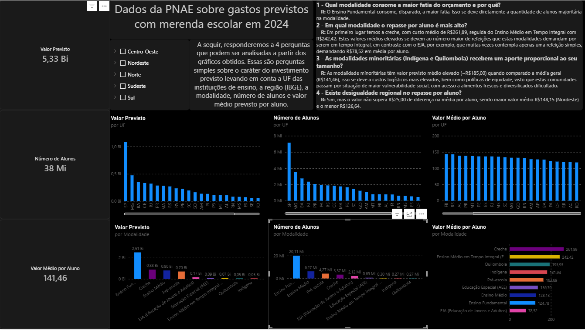

# Analise-de-Dados-PNAE-2024
Este repositório apresenta uma breve análise de dados oferecidos pela PNAE sobre repasses previstos para o ano de 2024 referente a merendas escolares do sistema público brasileiro.


# Análise de Dados: Previsão de Repasse Financeiro do PNAE 2024


## Sobre o Projeto
Este projeto tem como objetivo analisar a previsão de repasse financeiro do **Programa Nacional de Alimentação Escolar (PNAE)** para o ano de 2024 referente às merendas escolares do sistema público brasileiro. A partir dos dados brutos disponibilizados pelo FNDE, analisa-se como o orçamento está distribuído entre as diferentes modalidades de ensino, regiões do Brasil e o valor médio previsto por aluno.

Para demonstrar o domínio de diferentes ferramentas, o projeto foi desenvolvido em duas frentes independentes, partindo do mesmo arquivo bruto:
1. **Análise via Código (Python):** Limpeza, ETL, carga em banco de dados relacional (SQLite) e visualização com Matplotlib/Seaborn.
2. **Análise via Business Intelligence (Power BI):** ETL via Power Query, modelagem de dados e construção de dashboard interativo.

## Perguntas Respondidas
O projeto busca responder a 4 perguntas principais:
1. Qual modalidade consome a maior fatia do orçamento e por quê?
2. Em qual modalidade o repasse por aluno é mais alto?
3. As modalidades minoritárias (Indígena e Quilombola) recebem um aporte proporcional ao seu tamanho?
4. Existe disparidade regional no repasse por aluno?

## O Dashboard Interativo
Abaixo, a visualização final construída no Power BI.



### Principais Insights
* **Maior Orçamento:** O Ensino Fundamental consome a maior fatia (R$ 2,51 Bi), justificado pelo alto volume de alunos matriculados nesta modalidade, na rede pública.
* **Maior Repasse por Aluno:** A modalidade Creche possui o maior repasse médio por aluno (R$ 261,89), seguida pelo EMTI (R$ 242,42). Isso reflete o maior número de refeições demandadas para estas modalidades.
* **Equidade (Minorias):** Alunos de escolas Indígenas (R$ 193,93) e Quilombolas (R$ 181,84) recebem um repasse médio superior à média geral, refletindo maior vulnerabilidade dessas comunidades e políticas de valorização.
* **Disparidade Regional:** A região Nordeste possui o maior repasse médio por aluno (R$ 148,15), enquanto o Norte possui o menor (R$ 126,64). 

## Tecnologias e Ferramentas Utilizadas
- **Python 3.14**: Linguagem base para o pipeline de dados.
- **Pandas / Openpyxl**: Manipulação, limpeza e ETL dos dados.
- **SQLite**: Armazenamento dos dados tratados para consultas via SQL.
- **Matplotlib / Seaborn**: Geração de gráficos analíticos.
- **Power BI**: Criação do dashboard interativo e visualização de negócios.

## Estrutura do Repositório
```text
PNAE_analise/
├── dados/
│   ├── brutos/          # Arquivo Excel original (Fonte: FNDE)
│   └── tratados/        # Saídas em CSV e banco de dados SQLite
├── dashboards/
│   └── Analise_PNAE.pbix # Arquivo do Power BI
├── notebooks/
│   ├── Limpeza_PNAE.ipynb # Notebook de ETL e tratamento
│   └── analise_PNAE.ipynb # Notebook de queries SQL e gráficos
├── .gitignore
├── README.md
└── requirements.txt

## Referências e Leituras Complementares

- **Mudanças no PNAE reconhecem diversidade nos territórios tradicionais.** 
  ÓSocioBio, 25 de fevereiro de 2026. 
  Disponível em: [https://osociobio.org.br/...](https://osociobio.org.br/politicas-publicas/mudancas-no-pnae-reconhecem-diversidade-nos-territorios-tradicionais/)
